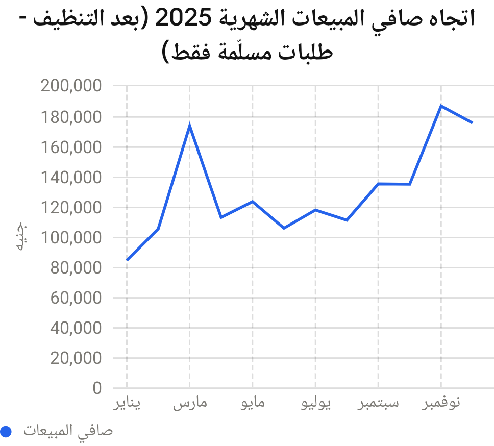
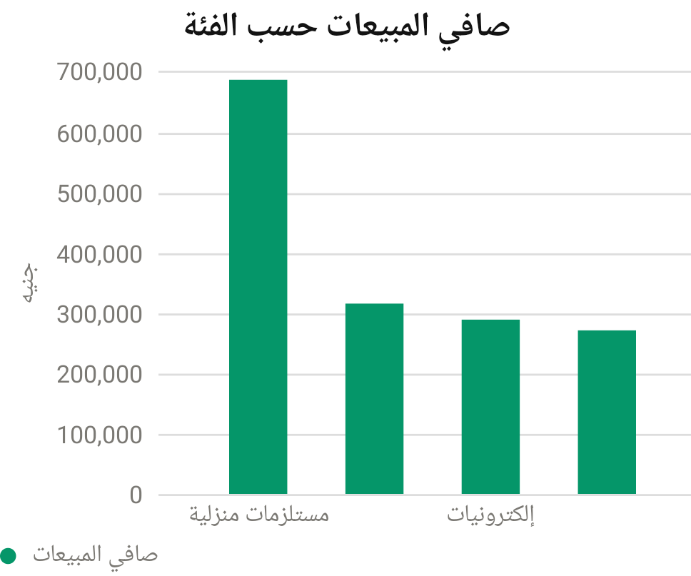
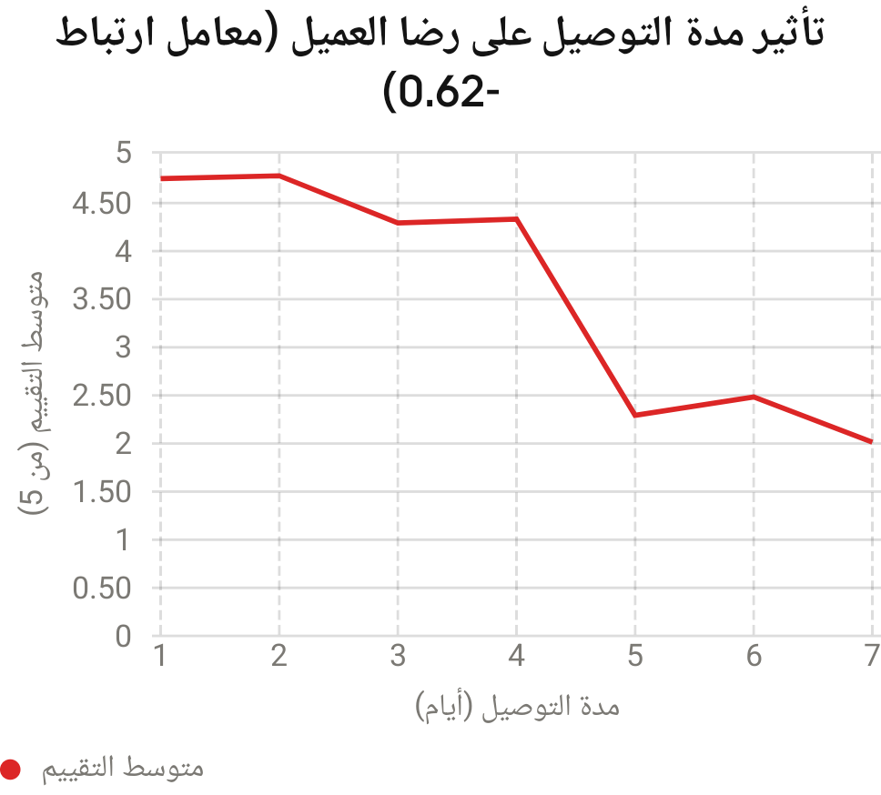

# Sales Analysis 2025

## Project Overview
An Excel-based sales analysis project for 2025.

## Tools
- Microsoft Excel
- Data Analysis
- Data Visualization

## Key Performance Indicators
- Total Sales: 1,566,426 EGP
- Total Profit: 429,588 EGP
- Profit Margin: 27.42%
- Delivered Orders: 969

## Analysis
- Sales by Category
- Sales by City
- Monthly Sales Trends
- Payment Methods
- Sales Channels
- Discount Impact on Profit
- Top 10 Products
- Customer Age Groups

## Project File
[Download Excel Analysis](../sales-analysis-2025.xlsx)

## Interactive Dashboard

Explore the full interactive Sales Dashboard:

[View Sales Dashboard – 2025](https://sites.google.com/view/abdalhalem-sales-2025/full-page-embed)

## Project Overview

This project presents a sales performance analysis for 2025 using Microsoft Excel.

The dashboard provides insights into:
- Sales Performance
- Product Categories
- Monthly Sales Trends
- Customer Behavior
- Delivery Performance
- Profitability Analysis
## Data Visualizations

### Monthly Sales Trend

### Sales by Category

### Delivery Time vs Customer Rating

